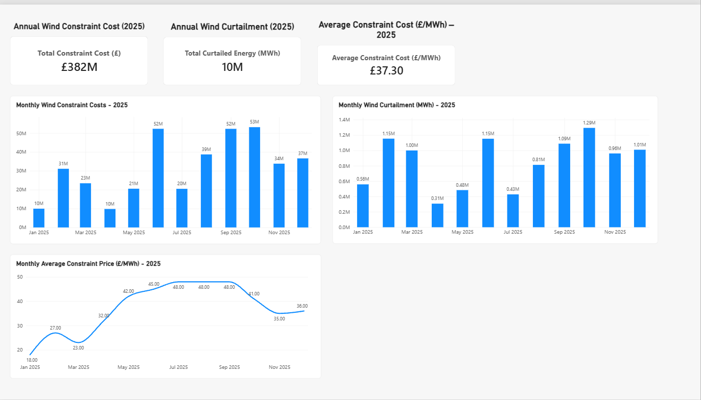
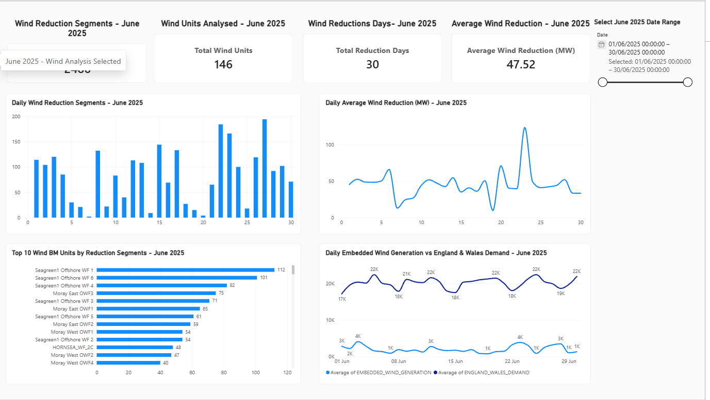
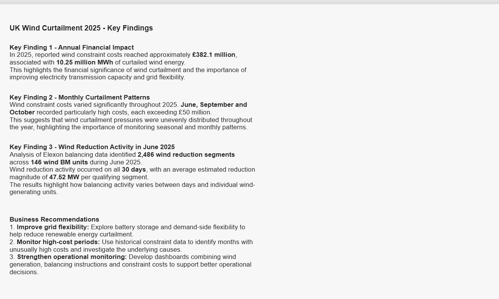

# UK Wind Curtailment Analysis - 2025

### Microsoft Fabric | PySpark | SQL | Power BI

## Project Overview
This project investigates wind energy curtailment costs in Great Britain during 2025, alongside wind-related balancing activity in June 2025.

The analysis uses Microsoft Fabric to integrate electricity market datasets, process data using PySpark, build analytical tables and create interactive Power BI dashboards.

## Business Problem
Wind farms may be instructed to reduce electricity generation when transmission network constraints prevent all available electricity from reaching consumers.

These constraints can lead to significant balancing costs and lost renewable generation.

**Project objectives:**
- Analyse annual wind constraint costs and curtailed energy.
- Identify monthly patterns and high-cost periods.
- Examine wind reduction activity across individual Balancing Mechanism (BM) units.
- Compare wind generation with electricity demand.
- Identify opportunities for improved grid flexibility and operational monitoring.

## Tools and Technologies
- **Microsoft Fabric:** End-to-end analytics platform
- **OneLake and Lakehouse:** Data storage and management
- **PySpark:** Data cleaning, transformation and processing
- **Delta Tables:** Structured analytical data storage
- **SQL:** Data validation and querying
- **Power BI:** Data modelling, DAX measures and interactive dashboards

## Data Sources
1. Renewable Energy Foundation - Wind constraint costs and energy volumes (2025).
2. Elexon - Bid-Offer Acceptance data (June 2025).
3. Elexon - BM Unit Reference Data.
4. NESO - Historic electricity demand data (2025).

## Key Findings

### Annual Wind Constraints - 2025
- Approximately **£382.1 million** in reported wind constraint costs.
- Approximately **10.25 million MWh** of curtailed wind energy.
- Average reported constraint cost of approximately **£37.30/MWh**.
- June, September and October recorded particularly high monthly costs.

### Wind Balancing Activity - June 2025
- **2,486** identified wind reduction segments.
- **146** wind BM units represented.
- Reduction activity identified across **30 days**.
- Average estimated reduction magnitude of **47.52 MW** per qualifying segment.

*Note: Elexon balancing acceptance segments are analysed separately from reported curtailed energy volumes. The June segment count is not equivalent to MWh of curtailed energy.*

## Power BI Dashboard

The report contains three pages:

1. **Annual Overview - 2025:** Constraint costs, curtailed energy, average costs and monthly trends.
2. **June 2025 - Wind Analysis:** Reduction activity, BM unit comparisons, daily patterns and wind generation versus demand.
3. **Key Insights & Recommendations:** Findings, business implications and suggested operational improvements.

### Power BI Dashboard Screenshots

**1. Annual Overview - 2025**

**2. June 2025 - Wind Analysis**

**3. Key Insights & Recommendations**

## Business Recommendations
- Investigate battery storage and demand-side flexibility to reduce renewable energy curtailment.
- Monitor unusually high-cost periods to identify recurring operational constraints.
- Integrate balancing activity, generation and constraint costs into regular operational reporting.

## Project Scope and Limitations
The annual constraint figures come from Renewable Energy Foundation reporting, while June balancing activity is derived from Elexon data.

These sources represent different analytical measures and should not be interpreted as directly interchangeable.

The June balancing analysis covers one month, whereas the constraint cost analysis covers the full year 2025.

## Project Author
Business Analytics portfolio project focused on UK electricity markets, energy data engineering and business intelligence.
